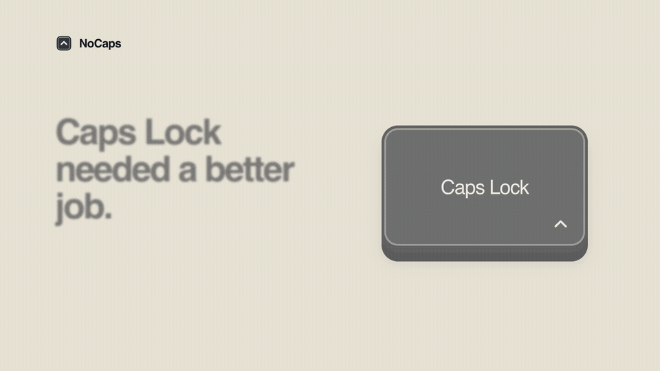

[](docs/nocaps.mp4)

<sub>Music: [Sascha Ende](https://ende.app/en), “Happy Beats / Business Moves, Vol. 12” ([CC BY 4.0](https://ende.app/en/standard-license)); excerpted and mixed.</sub>

# NoCaps

A super lightweight app that does one job: make Caps Lock **tap for Escape, hold for Control**.

NoCaps lives in your menu bar and works on macOS 13 or later, on Apple silicon
and Intel Macs.

## Install

Download [NoCaps.zip from the latest release](https://github.com/phucisstupid/nocaps/releases/latest),
unzip it, and move NoCaps to Applications.

Or install with Homebrew:

```sh
brew install --cask phucisstupid/tap/nocaps
```

Release builds are not notarized, so macOS may require approval before opening.

## Usage

Open NoCaps and allow keyboard access in **System Settings → Privacy & Security
→ Accessibility** (**Device Control and Data Access** on newer macOS).
Turn Caps Lock off if its light is on. After granting access, quit and reopen NoCaps
once. Later launches use the saved permission.

Use the menu to pause NoCaps or enable **Launch at Login**. Quit to restore Caps Lock.
If NoCaps crashes, reopen it to restore the key.

## Development

Requires Xcode 27. Run from the project folder:

```sh
bash scripts/lint.sh
bash scripts/build.sh
```

The build creates `build/NoCaps.zip`. See [AGENTS.md](AGENTS.md) for contributor instructions.
